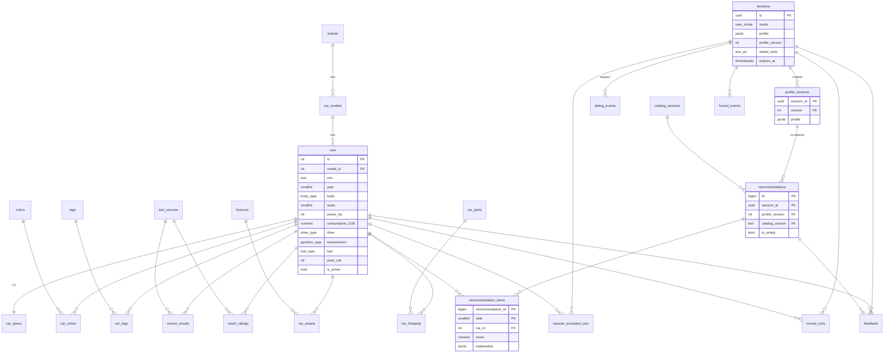

# База данных AutoChoice (PostgreSQL)

Файлы: [db/schema.sql](../db/schema.sql) — схема (PG 12+), [db/load_catalog.py](../db/load_catalog.py) — загрузка `data/catalog/cars.json`.

```powershell
psql -v ON_ERROR_STOP=1 -f db/schema.sql autochoice
python db/load_catalog.py postgresql://autochoice@localhost:5432/autochoice
```

## Идеи схемы

1. **Каталог нормализован.** Бренд → модель → комплектация (`cars`). Раньше всё лежало в одной таблице с JSONB-мешками `specs`, `colors`, `tags`, `hotspots`; теперь это типизированные колонки и связи, по ним работают индексы и ограничения.
2. **Факты о безопасности — с источником.** Результат лосиного теста и краш-рейтинг хранятся отдельно, со ссылкой (`test_sources`, `moose_results`, `crash_ratings`). Если реального результата нет, скорость считает модель из `car_specs.track_mm` и др.
3. **3D-ассеты с лицензией.** `car_assets` требует автора, если указана лицензия (CHECK). Лицензии лежат в `licences` с флагом «разрешено коммерческое использование» — по нему видно, что нельзя выкладывать публично.
4. **Пользователь анонимен.** Нет ни имени, ни почты; только профиль подбора и журнал диалога. Сессии истекают (`expires_at`).
5. **Выдача воспроизводима.** Каждое изменение профиля — новая версия в `profile_versions` (ведёт триггер). Выдача ссылается на версию профиля и версию каталога, поэтому «почему показали именно эту машину» восстанавливается.
6. **Качество измеряется SQL-ем.** Воронка (`funnel_events`), доля «нравится» (`v_car_feedback`), сравнение разбора текста (`dialog_events.parsed` против `nlu_examples.expected`).

## ER-диаграмма



## Группы таблиц

| Группа | Таблицы | Назначение |
|---|---|---|
| Каталог | `brands`, `car_models`, `cars`, `car_specs`, `colors`, `car_colors`, `tags`, `car_tags` | что можно рекомендовать |
| Безопасность | `test_sources`, `moose_results`, `crash_ratings` | реальные результаты тестов со ссылками |
| 3D и медиа | `licences`, `car_assets`, `car_parts`, `car_hotspots` | модели, лицензии, подсказки по деталям |
| Версии | `catalog_versions` | какой сид использовала выдача |
| Диалог | `sessions`, `session_excluded_cars`, `profile_versions`, `dialog_events` | анонимный подбор и его история |
| Результат | `recommendations`, `recommendation_items`, `feedback`, `moose_runs` | что показали и как отреагировали |
| Аналитика | `funnel_events`, `nlu_examples` | воронка и эталоны для проверки разбора текста |

Представления: `v_cars` (плоская карточка — тот же вид, что отдаёт `Car.to_dict()`), `v_car_hotspots`, `v_funnel`, `v_car_feedback`.

## Что гарантирует сама база

- Допустимые значения кузова, привода, коробки, топлива, режима — `ENUM`.
- Положительные цены, мощность, объём багажника; скорость лосиного теста 30–120 км/ч; рейтинг 0–5 звёзд.
- У ассета с лицензией обязан быть указан автор.
- Профиль сессии — всегда JSON-объект с ключами `hard` и `nice`.
- Выдача ссылается только на существующую версию профиля своей сессии.
- Версия профиля растёт автоматически при любом его изменении (триггер `sessions_bump`).
- Удаление сессии каскадно удаляет всю её историю; журнал воронки и запуски теста остаются обезличенными (`ON DELETE SET NULL`).
- Частичные индексы `cars_filter_idx`, `cars_body_idx` ускоряют жёсткий фильтр только по активным машинам.

## Проверка

Схема применена на PostgreSQL 12 (локальный кластер, отдельная база), загружены все 21 машина (12 брендов, 20 моделей, 697 подсказок, 7 лосиных тестов, 15 краш-рейтингов, 42 ассета). Проверено вручную: повторная загрузка не дублирует данные; запрос «семья, до 2 млн, 5+ мест» отдаёт Niva Travel, Vesta и Largus; триггер создаёт версии профиля 1→2→3; нарушения (отрицательная цена, неизвестный кузов, лицензия без автора, выдача по несуществующей версии, профиль не объектом) отклоняются; удаление сессии каскадом чистит историю; план запроса использует `cars_filter_idx`.

## Как приложение использует схему

- **Старт.** `app/database.py` при первом запуске применяет `db/schema.sql` (под advisory-lock, чтобы воркеры gunicorn не мешали друг другу). Если находит таблицы старой версии (`cars` с колонкой `brand`), переименовывает их в `legacy_cars` / `legacy_sessions` и ничего не удаляет.
- **Каталог.** `app/catalog.py` загружает `data/catalog/cars.json` и пропускает загрузку, если версия сида уже есть в `catalog_versions`. Машины, которых в сиде больше нет, получают `is_active = false`. Читает каталог один SQL-запрос по `v_cars` + `car_specs` + `v_car_hotspots`; формат карточки для фронта не изменился.
- **Сессии.** `app/models.py` описывает таблицы сессий и выдачи. Версию профиля ведёт триггер БД, приложение её не трогает.
- **Что пишет API.** `describe`, `answer`, правка чипов, замечания пишутся в `dialog_events` (текст, результат разбора, версия профиля); каждая выдача — в `recommendations` и `recommendation_items` (кого показали, оценка, объяснение); «Нравится / Не то» — в `feedback`; отвергнутые машины — в `session_excluded_cars`; шаги воронки — в `funnel_events`. Ответ `GET .../recommendation` теперь содержит `recommendation_id`.
- Ручная загрузка каталога: `python db/load_catalog.py <dsn>`. Dockerfile копирует `db/`.

## Что не сделано

- `moose_runs` не заполняется: заезд считается в браузере, а API отдаёт только вердикт, поэтому в воронку пишется шаг `moose`. Чтобы писать сам заезд (манёвр, скорость, итог), фронту нужно отправлять результат.
- Каждый `GET .../recommendation` пишет строку в `recommendations` (повторная загрузка страницы даёт новую запись). Если это мешает, можно дедуплицировать по `(session_id, profile_version)`.
- Миграции Alembic: пока схема ставится одним файлом на пустую базу. Для изменений схемы на боевой базе нужны миграции.
- Автоочистка просроченных сессий: `DELETE FROM sessions WHERE expires_at < now()` по cron или `pg_cron`.
- Русские подписи деталей в `car_parts.label_ru` пока взяты из id; настоящие есть в `parts.json`.
- Проверено на PostgreSQL 12 (локально); `docker compose` с PostgreSQL 16 не запускал.
